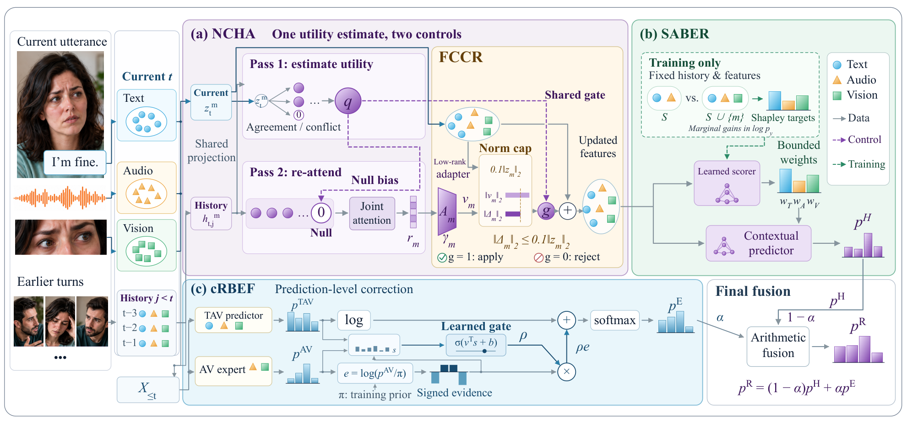

# HMBR

**Historical and Modal Bias Reassessment Mitigation for Multimodal Conversational Emotion Recognition**

[HMBR paper (PDF)](paper/ReCoMER.pdf) · [中文说明](README.zh-CN.md) · [Implementation and data interface](paper/IMPLEMENTATION.md) · [Reported results](paper/results.json)

HMBR predicts the emotion of a conversational utterance from text, audio and visual features. It estimates whether earlier turns help interpret the current utterance, limits how much they can change its representation, and then weights each modality by its estimated contribution. A separate audiovisual expert refines the prediction when nonverbal cues provide complementary evidence.



## Results

Tables 1–3 report support-weighted F1 (WF1) on three datasets.

| Dataset | HMBR WF1 (%) | Evaluation |
|---|---:|---|
| M3ED | **62.07** | Single run, official TV-series split |
| IEMOCAP | **78.53** | Mean of three runs, Session 5 held out |
| EmotionTalk | **72.03** | Single run, speaker-independent split |

## Method

- **NCHA** estimates whether earlier turns are useful. This estimate controls competition with a no-history option and a gate that admits or rejects historical feedback.
- **FCCR** learns a correction for each modality and bounds its norm relative to the current representation.
- **SABER** estimates each modality’s contribution after the history update. A scorer learns from Shapley targets during training and predicts bounded routing weights at inference.
- **cRBEF** compares an audiovisual expert’s predictions with the training class prior. A gate controls the strength of this correction before the expert and contextual predictions are combined.

On M3ED, Table 4 reports WF1 gains of 2.913 percentage points for NCHA, 3.290 for FCCR, 1.902 for SABER and 7.478 for cRBEF. Tables 5–8 report 14 comparisons of their internal mechanisms. Section 4.3 describes the variants used for each comparison. [Ablation results](paper/results.json)

## Quick start

Use Python 3.10 or later. The GitHub repository retains its original name, `ReCoMER`. Import the reference implementation as `recomer`.

```bash
git clone https://github.com/China-hanwudi/ReCoMER.git
cd ReCoMER
python -m pip install -e ".[dev]"
python scripts/demo_recomer.py
python -m pytest tests/recomer -q
python scripts/report_paper_results.py
```

The demo runs the contextual predictor and audiovisual correction on synthetic feature tensors on CPU. The results script prints the values recorded from the paper.

For M3ED features, the contextual predictor accepts text, audio and visual vectors of 2,560, 2,048 and 342 dimensions, respectively. This example runs one forward pass with synthetic features for the current utterance and three earlier turns.

```python
import torch
from recomer import ReCoMERConfig, ReCoMERContextModel

config = ReCoMERConfig(input_dims=(2560, 2048, 342), num_classes=7, dropout=0.25)
model = ReCoMERContextModel(config).eval()
dims = dict(zip(("text", "audio", "vision"), config.input_dims))
current = {name: torch.randn(1, dim) for name, dim in dims.items()}
history = {name: torch.randn(1, 3, dim) for name, dim in dims.items()}
with torch.no_grad():
    context_probabilities = model(current, history)["probabilities"]
```

The [input schema](paper/IMPLEMENTATION.md) describes tensor shapes, masks, speaker relations, training objectives and how to combine the contextual output with the expert predictions.

## Repository layout

| Path | Contents |
|---|---|
| [recomer/](recomer/) | PyTorch reference implementation |
| [configs/dataset_presets.json](configs/dataset_presets.json) | Dataset-specific model settings |
| [scripts/demo_recomer.py](scripts/demo_recomer.py) | Runnable synthetic example |
| [tests/recomer/](tests/recomer/) | CPU tests for the model components |
| [paper/](paper/) | HMBR manuscript, architecture figure, results and implementation notes |

Earlier research materials are available in [temporal_n3/](temporal_n3/) and [ReCoMER_paper_20261006/](ReCoMER_paper_20261006/).

## Citation and license

Use the [BibTeX entry](CITATION.bib) to cite the manuscript. Repository-owned code is distributed under the [MIT license](LICENSE). Datasets and pretrained feature extractors are available from their original providers under their respective terms.
