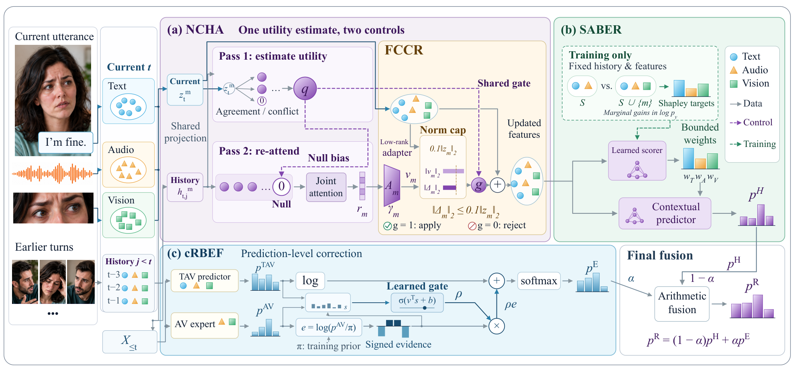

# HMBR

**Historical and Modal Bias Reassessment Mitigation for Multimodal Conversational Emotion Recognition**

[English](README.md) · [HMBR 论文（PDF）](paper/ReCoMER.pdf) · [实现与数据接口](paper/IMPLEMENTATION.md) · [实验结果](paper/results.json)

HMBR 根据文本、音频和视觉特征识别当前话语的情感。模型先判断先前话轮能否帮助理解当前话语，限制历史信息对当前表示的影响，再根据各模态在当前语境中的贡献分配权重。独立的音视频专家利用非语言线索进一步校正预测。



## 实验结果

论文表 1–3 报告三个数据集上的加权 F1（WF1），计算时按各类别的样本数加权。

| 数据集 | HMBR WF1（%） | 评估方式 |
|---|---:|---|
| M3ED | **62.07** | 单次运行，采用官方按电视剧划分的数据集 |
| IEMOCAP | **78.53** | 三次运行均值，使用 Session 5 测试 |
| EmotionTalk | **72.03** | 单次运行，采用说话人独立划分 |

## 模型方法

- **NCHA** 估计先前话轮是否有助于理解当前话语。模型据此调整历史话轮与空候选的竞争，并通过门控决定是否引入历史反馈。
- **FCCR** 为每种模态学习校正量，并根据当前表示的范数限制校正幅度。
- **SABER** 在历史更新后估计各模态的贡献。训练时使用 Shapley 目标监督评分器，推理时由评分器直接给出有界的模态权重。
- **cRBEF** 对比音视频专家的预测与训练集类别先验，用门控调节校正强度，再融合专家分支和上下文分支的预测。

表 4 报告 M3ED 上四个模块的 WF1 增益，单位为百分点。NCHA 为 +2.913，FCCR 为 +3.290，SABER 为 +1.902，cRBEF 为 +7.478。表 5–8 报告 14 项模块内部机制对比，第 4.3 节说明各项比较使用的模型变体。[消融实验结果](paper/results.json)

## 快速开始

需要 Python 3.10 或更高版本。仓库沿用名称 `ReCoMER`，Python 包的导入路径为 `recomer`。

```bash
git clone https://github.com/China-hanwudi/ReCoMER.git
cd ReCoMER
python -m pip install -e ".[dev]"
python scripts/demo_recomer.py
python -m pytest tests/recomer -q
python scripts/report_paper_results.py
```

示例在 CPU 上使用合成特征运行上下文预测与音视频校正。结果脚本读取并打印论文报告的数值。M3ED 使用 2,560 维文本、2,048 维音频和 342 维视觉特征。输入张量形状、可用性掩码、训练目标和预测融合方式见[实现说明](paper/IMPLEMENTATION.md)。

早期研究材料位于 [temporal_n3/](temporal_n3/) 和 [ReCoMER_paper_20261006/](ReCoMER_paper_20261006/)。

## 引用与许可

引用论文可使用 [BibTeX 条目](CITATION.bib)。仓库自有代码采用 [MIT 许可证](LICENSE)，数据集和预训练特征提取器的使用条件以各自提供方为准。
