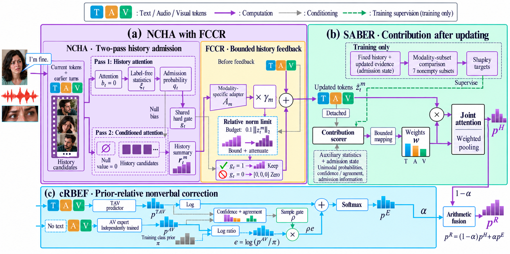

# ReCoMER

**通过可靠性与上下文建模缓解多模态对话情感识别中的偏差**

[English](README.md) · [论文 PDF](paper/ReCoMER.pdf) · [方法与输入接口](paper/IMPLEMENTATION.md) · [论文结果](paper/results.json)

ReCoMER 将历史准入、有界历史反馈与更新后的模态贡献估计相衔接，并通过独立的音视频预测路径提供先验相对的非语言证据。



## 论文主结果

| 数据集 | WF1（%） | ACC（%） | 说明 |
|---|---:|---:|---|
| M3ED | **62.07** | — | 相对表中 MF-EDM 的 WF1 增益为 7.02% |
| IEMOCAP | **78.53** | — | 三次运行均值，样本标准差 0.04% |
| EmotionTalk | **72.03** | **72.52** | 相对表中 LMF 的 ACC 增益为 1.29% |

性能增益表示百分制得分的差值。结果遵循论文中的评估协议；M3ED、EmotionTalk 报告单次结果，IEMOCAP 报告多次均值。EmotionTalk 的本文 WF1 与文献来源的 F1 分别标明。

## 四个模块

- **NCHA：条件化历史准入。** 首轮历史读取提供准入估计，随后调节第二轮空候选竞争，并控制共享准入决定。
- **FCCR：有界历史反馈。** 模态专属残差适配器在相对范数预算内重评当前表示。
- **SABER：更新后的贡献路由。** 固定历史状态下的 Shapley 监督引导有界模态权重，推理仅需一次评分。
- **cRBEF：先验相对非语言校正。** 独立 AV 专家提供类别证据，语句级门控调节强度，算术融合组合完整预测。

论文所选匹配比较中的增益分别为 **NCHA +2.913%、FCCR +3.290%、SABER +1.902%、cRBEF +7.478%**。各项对应各自的比较条件，不能相加；完整的 18 项机制结果见[结果记录](paper/results.json)。

## 使用

```bash
git clone https://github.com/China-hanwudi/ReCoMER.git
cd ReCoMER
python -m pip install -e ".[dev]"
python scripts/demo_recomer.py
python -m pytest tests/recomer -q
python scripts/report_paper_results.py
```

当前 Python 包提供论文核心机制的清晰参考实现。示例使用合成特征在 CPU 上验证预测流程；主结果表来自论文实验。特征维度、类别顺序及冻结预测参数应与自己的实际数据和训练产物匹配，接口说明见 [IMPLEMENTATION.md](paper/IMPLEMENTATION.md)。

## 效率

论文报告完整模型 **13.121M 参数**，RTX 5090 上每条语句 **1.401 ms**。NCHA、FCCR、SABER 合计增加 **0.086M 参数（0.66%）**。计时为八段开发集对话、187 条语句的预热后五次中位数，包含专家计算，不含特征提取、传输与加载。

旧 TemporalN3 与早期论文目录保留，当前入口以本页链接的 ReCoMER 包和论文为准。原有提交历史和数据保留。自有代码沿用 [MIT 许可证](LICENSE)，数据与第三方模型遵循各自来源的使用条件。
